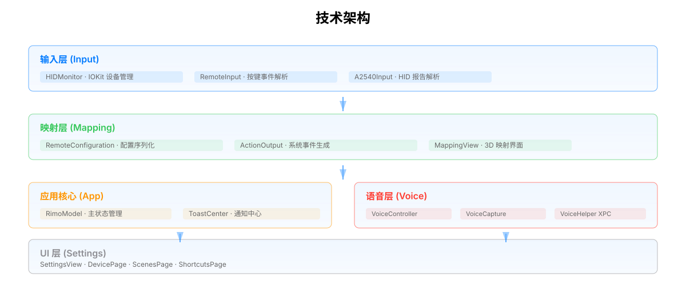

<div align="center">


<p align="center">
  <strong>用 Apple TV 遥控器控制 Mac</strong>
</p>

<p align="center">
  自定义按键映射 · 语音输入 · 场景切换
</p>

<br/>

<p align="center">
  <a href="#特性">特性</a> •
  <a href="#快速开始">快速开始</a> •
  <a href="#使用指南">使用指南</a> •
  <a href="#技术架构">技术架构</a> •
  <a href="#文档">文档</a>
</p>

<p align="center">
  
  
  
  
</p>

</div>

---

## 特性

Rimo 将 Apple TV Siri Remote (A2540) 转变为强大的 Mac 输入设备。为每个按键自定义操作，为不同应用切换场景，甚至使用遥控器进行语音输入。


### 🎮 灵活的按键映射
- **三种触发方式**：单击、双击、长按分别配置
- **丰富的动作类型**：键盘快捷键、鼠标操作、滚动控制、媒体键、系统操作、打开 App、文本输入、系统快捷指令
- **实时反馈**：按键时 3D 模型高亮显示，映射立即生效

### 🎯 智能场景切换
- **应用识别**：根据前台 App 自动切换映射配置
- **预设场景**：内置演示翻页、长文阅读、网页视频预设
- **全局回退**：未匹配场景时使用全局映射

### 🎤 遥控器语音（实验性）
- **虚拟麦克风**：通过 XPC 服务提供 "Rimo Remote Microphone"
- **Opus 编解码**：实时音频流处理，支持丢帧补偿
- **输入法集成**：映射 Siri 键为语音快捷键，直接输入到当前应用

---

## 快速开始

### 前提条件

- macOS 13.0 或更新版本
- Xcode 26 或更新版本（支持 Swift 6）
- Opus 库（通过 Homebrew 安装）
- Apple TV Siri Remote A2540

### 从源码构建

```bash
# 1. 克隆仓库
git clone https://github.com/Yohoia/Rimo.git
cd Rimo

# 2. 安装 Opus 库
brew install opus

# 3. 编译项目
xcodebuild -project Rimo.xcodeproj -scheme Rimo -configuration Debug \
  -derivedDataPath .build/xcode RIMO_OPUS_PREFIX="$(brew --prefix opus)" build

# 4. 运行应用
open .build/xcode/Build/Products/Debug/Rimo.app
```

也可以在 Xcode 中打开 `Rimo.xcodeproj` 并直接运行。

### 运行测试

```bash
xcodebuild test -scheme Rimo -derivedDataPath .build/xcode
```

---

## 使用指南

### 1️⃣ 配对遥控器

在 **系统设置 → 蓝牙** 中配对 Apple TV Siri Remote (A2540)，然后打开 Rimo 确认连接状态。

### 2️⃣ 授予权限

在 Rimo 的**设备设置**中点击「授予权限」，开启以下权限：
- **输入监控**：读取遥控器按键
- **辅助功能**：发送键盘映射事件

> 💡 授权后需要**退出并重新打开** Rimo，确认权限显示「已允许」。

### 3️⃣ 配置按键

1. 点击首页的遥控器进入 3D 映射界面
2. 点击要配置的按键，视图会放大该区域
3. 在右侧「动作」侧栏选择操作：
   - 🔵 **单击**：一个圆点
   - 🔵🔵 **双击**：两个圆点  
   - ➖ **长按**：短横线
4. 选择动作后，按实体遥控器验证效果

### 4️⃣ 场景管理（可选）

- 点击右上角「添加应用程序」为特定 App 设置专属映射
- 在「场景」页面开启自动切换
- 应用内置预设：演示翻页、长文阅读、网页视频

### 权限故障排查

**症状**：权限列表中没有 Rimo，或映射没有效果

**解决方法**：
1. 在「系统设置 → 隐私与安全 → 输入监控/辅助功能」中点击「+」
2. 按 `⌘⇧G` 输入 Rimo.app 的**完整路径**
3. 开启权限开关，退出并重新打开 Rimo
4. 确认设备设置中显示「已允许」

> 📝 每次重新编译后，需要重新添加权限。

---

## 技术架构

Rimo 使用纯 Swift + SwiftUI 构建，采用分层架构设计：



### 核心模块

| 模块 | 职责 | 关键组件 |
|------|------|----------|
| **输入层 (Input)** | HID 设备管理和按键解析 | `HIDMonitor`, `RemoteInput`, `A2540Input` |
| **映射层 (Mapping)** | 配置管理和事件转换 | `RemoteConfiguration`, `ActionOutput`, `MappingView` |
| **语音层 (Voice)** | 音频捕获和编解码 | `VoiceController`, `VoiceCapture`, `VoiceHelperServer` |
| **应用核心 (App)** | 状态管理和通知 | `RimoModel`, `RimoToastCenter` |
| **UI 层 (Settings)** | 设置界面 | `SettingsView`, `DevicePage`, `ScenesPage` |

### 技术亮点

- ✅ **并发安全**：Swift 6 strict concurrency，@MainActor 隔离
- ✅ **Generation-based tracking**：防止状态混乱和双重清理
- ✅ **XPC 特权服务**：安全的虚拟麦克风实现
- ✅ **性能优化**：电池查询缓存，减少 IOKit 调用
- ✅ **完整测试**：单元测试覆盖核心模块

---

## 文档

### 设计与规范
- [**DESIGN.md**](DESIGN.md) - UI/UX 设计规范和视觉系统
- [**docs/brand/**](docs/brand/) - 品牌资源和使用指南

### 功能与产品
- [**docs/product-scope.md**](docs/product-scope.md) - 产品功能范围和设计决策
- [**docs/action-mapping-catalog.md**](docs/action-mapping-catalog.md) - 完整的动作映射目录
- [**docs/optionsplus-main-findings.md**](docs/optionsplus-main-findings.md) - Options+ 对比分析

### 技术文档
- [**docs/device-interface.md**](docs/device-interface.md) - A2540 设备接口和协议
- [**docs/voice-validation.md**](docs/voice-validation.md) - 语音捕获验证方法
- [**docs/PERFORMANCE.md**](docs/PERFORMANCE.md) - 性能优化指南

### 开发与贡献
- [**IMPROVEMENTS.md**](IMPROVEMENTS.md) - 代码审查和改进报告

---

## 测试

测试文件位于 `Tests/` 目录，覆盖核心功能：

- ✅ **RemoteConfigurationTest** - 配置序列化和验证
- ✅ **VoiceCaptureTest** - Opus 编解码和音频流
- ✅ **VoiceSessionTest** - 语音会话状态机
- ✅ **VoiceHelperTest** - XPC 服务和权限验证
- ✅ **MappingPauseTest** - 映射暂停和恢复
- ✅ **ToastTest** - Toast 通知系统

```bash
xcodebuild test -scheme Rimo -derivedDataPath .build/xcode
```

---

## 许可证

本项目代码使用 [MIT 许可证](LICENSE)。

设计资源和品牌素材的使用请查看 [docs/brand/README.md](docs/brand/README.md)。

---

<div align="center">

**开发者**: [Yohoia](https://github.com/Yohoia)  
**构建状态**: ✅ BUILD SUCCEEDED  
**最近审查**: 2026-11-21 · 修复 16 个并发和内存安全问题

<sub>用 ❤️ 和 Swift 构建</sub>

</div>
